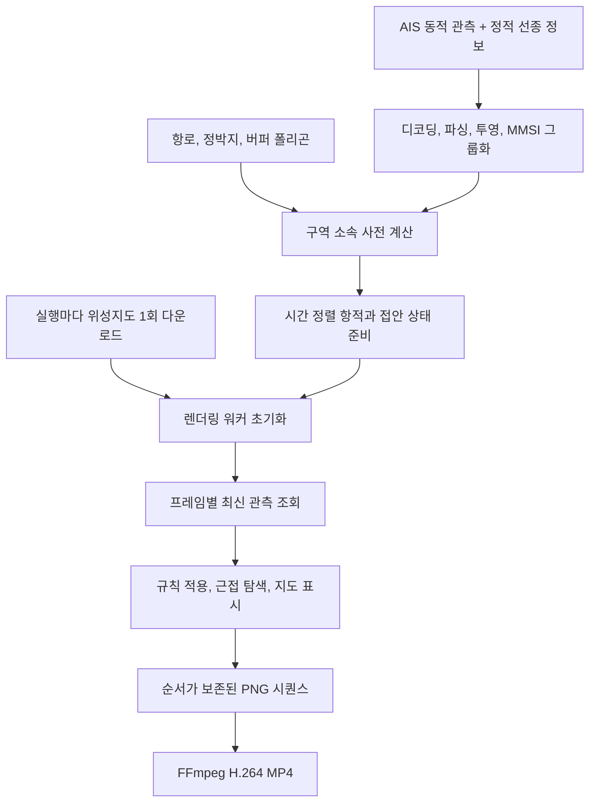

<div align="center">

# 부산 AIS 선박 행위 분석

**선박 항적을 해석 가능한 해상교통 행위 지표로.**

규칙 기반 공간 분석 · 선박 활동 후보 식별 · 위성지도 타임랩스

[English](README.md) · **한국어**


[About](#about) · [Highlights](#highlights) · [연구 발표](#research-presentations) · [Demo](#demo) · [시작하기](#시작하기) · [Validation](#validation) · [Notes](#notes)

</div>

## About

부산 주변의 과거 AIS(선박자동식별장치) 관측 자료를 선박 행위의 시각적 지표로 변환하는 프로젝트입니다. 속력, 선수 방위, 연속 위치, 선종 정보, 폴리곤 내부 여부를 결합해 정지 선박, 저속 이동, 항로 밖 이동 및 운항 활동 후보를 표시합니다.

핵심은 **검토 가능한 판정 규칙과 공간적 맥락**입니다. 각 표시를 명시적인 임계값으로 추적하고 주변 교통 상황과 함께 검토할 수 있습니다. 두 Python 파이프라인은 Esri World Imagery 위에 선종별 색상과 한글 범례를 적용한 타임랩스 MP4를 생성합니다.

| 파이프라인 | 실행 파일 | 분석 결과 |
|---|---|---|
| 항행 상태 | [`3docked_video_demo.py`](3docked_video_demo.py) | 정지·정박 지표, 정류 후보, 항로 밖 이동 지표, SOG 라벨과 방향 화살표 |
| 운항 활동 | [`2acting_video2_demo.py`](2acting_video2_demo.py) | 상태를 유지하는 접안 후보, 조업 후보, 예인 관련 근접 지표 |

> [!IMPORTANT]
> 표시된 행위는 **규칙으로 추정한 후보**입니다. AIS만으로 실제 하역·조업·예인 관계·위험 운항을 확정할 수 없습니다. 정답 라벨에 기반한 정확도 벤치마크는 제공하지 않습니다.

## Highlights

- **투명한 분류 규칙:** 속력·이동 거리·선수 방위 변화·구역 소속으로 판정합니다. 학습 모델이나 숨겨진 점수를 사용하지 않습니다.
- **상호 보완적인 두 관점:** 항행 상태와 운항 활동을 나누어 이동 패턴과 선박 간 관계를 검토합니다.
- **공간 연산 사전 처리:** GeoPandas 공간 조인으로 항로·정박지·버퍼 소속을 미리 계산하고, 활동 렌더러는 프레임마다 KD-tree로 근접 선박을 찾습니다.
- **선박별 시계열 처리:** MMSI별 항적을 정렬하고 `numpy.searchsorted`로 최신 관측을 조회합니다. 접안 상태는 병렬 렌더링 전에 계산합니다.
- **병렬 영상 생성:** 프로세스 풀로 3000 × 2000 RGB 프레임을 생성하고 순서가 보존되는 `imap` 결과를 임시 PNG로 저장한 뒤 FFmpeg로 인코딩합니다.
- **근거가 드러나는 문서:** 로컬 입력 목록, 데이터 품질 점검 결과, 검증 한계를 [검증 보고서](VALIDATION.md)에 기록했습니다.

<a id="research-presentations"></a>

## 연구 발표 · 포스터와 워크숍

공개 코드와 함께 연구의 배경·방법·예시를 확인할 수 있도록 2024년 학회 포스터와 2025년 워크숍 발표자료를 연결합니다. 문서의 연구 설정과 현재 공개 코드의 구현은 동일하다고 가정하지 않습니다.

| 자료 | 맥락 | 원문 |
|---|---|---|
| 2024 학회 포스터 | 한국해양환경에너지학회 추계학술대회 · 실시간 선박 데이터 추적을 통한 정박·정류 감지 및 행위식별 연구 | [한국어 원문 PDF](https://fortranmentis.github.io/assets/research/ais-poster-ko.pdf) · [English translation PDF](https://fortranmentis.github.io/assets/research/ais-poster-en.pdf) |
| 2025 워크숍 발표 | **2025.01.14**, 해상교통망 운영관리를 위한 기술교류 워크숍 · 발표자 이상학 | [PPTX · 31.2 MB](https://fortranmentis.github.io/assets/research/ais-workshop-2025.pptx) |

영문 포스터는 제공받은 번역본이며 원래 영문으로 학회에 제출한 자료라고 표시하지 않습니다. 원문은 GitHub Pages에서 제공합니다.

### 워크숍에서 소개한 연구 방법

- **자료:** 2022년 부산 해역 AIS 정적정보(선박 ID·종류 등)와 동적정보(시각·위치·SOG·침로·선수방위)를 결합합니다.
- **처리:** Python multiprocessing과 순서가 유지되는 `imap` 출력을 이용한 처리 구조를 설명합니다.
- **이동 상태:** 좌표·속도·방위·항로/정박지 소속과 원호형·직선·Z형 이동 패턴을 참고해 정박·정류·항로 이탈 기준을 구성합니다.
- **선종별 행위:** 어선, 견인·예인선, 요트·유람선, 쾌속·여객선, 화물선, 유조선 등 6개 묶음별로 저속 지속·항구 소속·선박 동행을 활용한 후보를 표시합니다.

<table>
<tr>
<td width="50%"><a href="https://fortranmentis.github.io/assets/research/ais-workshop-navigation.webp"></a><p>발표 10쪽 · 정박·정류·항로 이탈</p></td>
<td width="50%"><a href="https://fortranmentis.github.io/assets/research/ais-workshop-activities.webp"></a><p>발표 11쪽 · 선종별 행위 후보</p></td>
</tr>
</table>

발표자료의 내장 이미지를 자르지 않고 사용했으며 범례와 Esri 등 배경지도 출처를 유지했습니다. 실제 활동의 정답 라벨이나 정확도 평가 결과는 아닙니다.

### 발표 설정과 공개 코드의 차이

| 항목 | 발표자료 | 현재 README에 기록된 공개 구현 |
|---|---|---|
| 저속 기준 | 0.5 knot 미만을 연구 분류 기준으로 소개 | `SOG_STOPPED = 2.1` knot 및 공간·변위·방위 조건 |
| 항로 이탈 표시 | 5분 유지, 재진입 시 해제 설명 | 이전/최신 관측의 항로 소속 전이, 관측 간격 `< 600 s`; 다음 AIS 관측까지 같은 쌍이 재사용될 수 있음 |
| 시간·실행 | 1초 갱신·표출 설정의 연구 시스템 소개 | 과거 AIS를 `FRAME_STEP_SEC = 1`로 표본화해 PNG·MP4 생성; 실시간 스트림 수집·운영 검증 아님 |
| 후속 과제 | 바람·조류 결합, 정류 패턴 고도화, 선박별 항적과 사고 감지 제안 | 해당 제안을 현재 두 데모에 모두 구현했다고 주장하지 않음 |

따라서 아래 **판정 규칙**는 공개 코드 기준으로 유지합니다. 연구자료의 임계값으로 코드를 바꾼 것은 아니며, 원문과 코드 간 기능·버전 차이를 기록한 것입니다. [검증 기록](VALIDATION.md)은 분류 정확도·현업 실시간 성능을 인증하지 않습니다.

<details>
<summary>2024 학회 포스터 미리보기</summary>

<table><tr>
<td width="50%"><a href="https://fortranmentis.github.io/assets/research/ais-poster-en.pdf"></a><p>English translation</p></td>
<td width="50%"><a href="https://fortranmentis.github.io/assets/research/ais-poster-ko.pdf"></a><p>한국어 원문</p></td>
</tr></table>

</details>

[워크숍 연구 소개](https://fortranmentis.github.io/ko/#ais-workshop) · [학회 포스터 보기](https://fortranmentis.github.io/ko/#research)

## Demo

| 항행 상태 | 운항 활동 |
|:---:|:---:|
|  |  |
| [MP4 보기](assets/ship_movement_DOCK_SPEED_demo2.mp4) · `3docked_video_demo.py` | [MP4 보기](assets/ship_movement_act2_demo.mp4) · `2acting_video2_demo.py` |

**표시 읽기:** 채운 원은 정지 또는 유지 중인 접안 상태입니다. 항행 화면의 노란 테두리는 정류 후보, 빨간 테두리는 항로 내부→외부 전환입니다. 활동 화면의 파란 테두리는 조업 후보, 노란 테두리는 예인 관련 후보입니다. 선종 색상과 행위 표시는 구분해서 읽어야 합니다.

두 GIF는 각각 720 × 480, 167프레임, 재생시간 16.7초입니다. 기존 시각화 예시이며, 생성 설정이나 현재 코드와의 일치 여부는 재검증하지 않았습니다.

## 시작하기

### 1. 저장소와 환경 준비

Python 3.10+ 환경을 권장합니다. 의존성 버전 고정이나 검증된 버전 조합은 제공하지 않습니다. 사용하는 라이브러리와 FFmpeg를 모두 설치하는 예시는 다음과 같습니다.

```bash
git clone https://github.com/fortranmentis/Busan-AIS-ship-behavior-analysis.git
cd Busan-AIS-ship-behavior-analysis
conda create -n busan-ais -c conda-forge python=3.10 pandas numpy geopandas shapely matplotlib contextily scipy pillow tqdm psutil ffmpeg
conda activate busan-ais
```

한글 폰트(Windows 맑은 고딕 또는 지원되는 나눔 폰트)와 지도 다운로드용 네트워크도 필요합니다. GPU는 선택 사항입니다. 항행 파이프라인은 NVENC를 요청하고 실패 시 `libx264`로 전환하며, 활동 파이프라인은 기본 `libx264`를 사용합니다.

### 2. 입력 파일 준비

공개 저장소에는 데모 스크립트, 공통 모듈, 문서와 미디어가 포함됩니다. **AIS CSV와 Shapefile은 `.gitignore`로 제외된 로컬 입력**이므로 복제 후 별도로 준비해야 합니다.

아래 파일을 스크립트 옆에 두거나 각 `main()`의 경로를 수정하세요. 두 실행 파일은 작업 디렉터리를 스크립트 위치로 변경합니다.

| 입력 | 사용 파이프라인 | 역할 |
|---|---|---|
| `busan_AIS2.csv` | 공통 | AIS 동적 관측 |
| `Static.csv` | 공통 | MMSI별 선종 조회 |
| `제1광역항로_5.shp`, `제2광역항로_5.shp`, `지선항로_5.shp`, `고시항로_2023.shp` | 공통 | 병합 항로; 활동에서는 지도 표시용 |
| `고시정박지_2023.shp`, `정박지(KOMC)_2023_병합.shp`, `무역항_2024.shp` | 항행 | 무역항까지 포함한 `in_anchorage` 판정 구역 |
| `100m버퍼3.shp` | 활동 | `in_port` 및 접안 상태용 버퍼 |

`.shp`, `.shx`, `.dbf`, `.prj`와 제공된 `.cpg`를 함께 보관하세요. 참조하는 로컬 레이어 8개는 WGS 84 경위도 좌표계로 선언되어 있습니다. 로더는 **원본 CRS를 EPSG:4326으로 덮어쓴 뒤** EPSG:3857로 변환하고 `buffer(0)`을 적용합니다. 실제 좌표도 WGS 84여야 합니다. 좌표계 지정은 좌표 변환이 아닙니다. 로컬 `100m버퍼2.shp`는 UTM Zone 52N이므로 그대로 대체하면 안 됩니다.

### 3. 미리보기 생성

```bash
python 3docked_video_demo.py --frames 100 --fps 30 --output navigation_preview.mp4
python 2acting_video2_demo.py --frames 100 --fps 30 --output activity_preview.mp4
```

입력과 미리보기를 확인한 뒤 프레임 수를 늘리세요.

```bash
python 3docked_video_demo.py --frames 1000 --fps 30 --output navigation_1000.mp4
```

| 옵션 | 기본값 | 의미 |
|---|---|---|
| `--frames` | `100` | 요청 프레임 상한; 입력 시간 범위로도 제한됨 |
| `--fps` | `30` | 영상 재생 프레임레이트 |
| `--output` | `ship_movement_DOCK_SPEED_demo2.mp4` / `ship_movement_act2_demo.mp4` | 항행 / 활동 출력 경로 |

`FRAME_STEP_SEC = 1`에서 1,000프레임은 시작 후 0–999초를 조회하고 30 FPS에서 약 33.3초 영상이 됩니다. 재생 속도는 판정 임계값을 바꾸지 않습니다. 프레임 수·FPS는 양수, 입력 시간 범위는 0보다 커야 합니다. 같은 이름의 출력은 FFmpeg가 덮어씁니다.

## 데이터 명세

| 데이터 | 필드 | 의미·기대값 |
|---|---|---|
| 동적 | `MMSI` | 선박 식별자; 동적·정적 파일에서 같은 표현 사용 |
| 동적 | `일시` | `%Y-%m-%d %H:%M:%S`; 코드에서 시간대 미지정 |
| 동적 | `경도`, `위도` | WGS 84 경위도, 도 단위 |
| 동적 | `SOG` | 대지속력, 노트 단위 |
| 동적 | `Heading` | 선수 방위; 미수신 값 `511`도 그대로 사용 |
| 동적 | `COG` | 항행 화살표용 선택 필드; 없거나 결측이면 `Heading` 사용 |
| 정적 | `MMSI`, `선종코드` | 식별자와 AIS 선종코드; 나머지 필드는 데모에서 미사용 |

CSV는 UTF-8 BOM → CP949 → EUC-KR → UTF-8 순서로 읽기를 시도합니다. 동적 관측에 별도 정제 단계는 없습니다. 정적 파일은 `on_bad_lines='skip'`으로 읽으며 MMSI 중복이면 마지막 값이 남습니다. 해석 전에 파싱 손실, 시각 중복, 좌표 품질, 정적 결합률을 확인하세요.

<details>
<summary><strong>선종별 색상</strong></summary>

| AIS 선종코드 | 표시 그룹 | 색상 |
|---|---|---|
| `30` | 어선 | 파랑 |
| `31`, `32`, `50`, `52` | 견인·도선·예인 그룹 | 노랑 |
| `36`, `37` | 범선·레저선 | 연두 |
| `40–49`, `60–69` | 고속선·여객선 | 분홍 |
| `70–79` | 화물선 | 주황 |
| `80–89` | 유조선 | 빨강 |
| 기타·결측·미결합 | 미분류 | 회색 |

예인 관련 규칙은 도선선까지 포함한 노란 그룹 전체에 적용됩니다. 예인선 코드 `52`에만 적용되는 규칙이 아닙니다.

</details>

## 판정 규칙

현재 구현을 설명하는 임계값이며 실증 검증된 운항 기준은 아닙니다. 이전 관측은 같은 MMSI의 바로 앞 관측입니다.

### 항행 상태

| 지표 | 구현 조건 | 표시 |
|---|---|---|
| 판정 구역 안 정지 | `SOG ≤ 2.1 kn`이고 `in_anchorage` | 선종색 채운 원 |
| 판정 구역 밖 정지 | `SOG ≤ 2.1 kn`, 이전 관측 존재, 간격 `≤ 200초`, 그리고 (이동 `≤ 10 m` **또는** 원형 각도차를 적용한 Heading 변화 `≥ 10°`) | 선종색 채운 원 |
| 정류 후보 | 같은 저속·이전 관측·시간 조건에서 이동 `> 10 m` **그리고** Heading 변화 `< 10°` | 노란 테두리와 선박 마커 |
| 항로 밖 이동 | 이전 관측은 병합 항로 안, 최신 관측은 밖, 관측 간격 **`< 600초`** | 정지 판정과 독립적인 빨간 테두리 |
| 나머지 관측 | 채운 정지 원을 그리지 않은 경우; 이전 관측이 없거나 오래된 저속 선박도 포함 | 방향 선박 마커 |

거리는 경위도 haversine으로 계산합니다. 모든 저속 선박에 정류 표시를 그리는 것은 아닙니다. 항로 밖 이동은 구역 소속 변화이며 위반을 확정하지 않습니다. 관측 쌍을 재사용하므로 다음 AIS 관측까지 빨간 표시가 유지될 수 있습니다.

`SOG > 0`이면 속력 라벨을 표시하고 정지 선박을 포함한 모든 표시 선박에 방향 화살표를 그립니다. `in_anchorage`는 정박지와 **무역항**의 합집합이므로 채운 원만으로 실제 투묘와 항만 내 정지를 구분할 수 없습니다.

### 운항 활동

| 지표 | 구현 조건 | 표시 |
|---|---|---|
| 접안 후보 | 버퍼 내부이고 `SOG ≤ 2.1 kn`이면 진입; `SOG > 2.1 kn`이면 해제; 나머지는 직전 상태 유지 | 선종색 채운 원 |
| 조업 후보 | 접안이 아니며 파란 선종 그룹, `0 ≤ SOG ≤ 5 kn` | 파란 테두리 |
| 예인 관련 후보 | 접안이 아니며 노란 그룹, `0.5 ≤ SOG ≤ 8 kn`, `PROXIMITY_RADIUS` 안에 다른 표시 선박 존재 | 노란 테두리 |

접안은 표시 우선순위가 높아 활동 테두리를 생략합니다. 100 m 버퍼 폭은 파일명에서 추정되는 명목값으로 생성 과정을 검증하지 않았습니다. 근접 판정은 표시되는 최신 위치 전체를 사용하며 상대 선종·방위·지속시간·관측 신선도 조건은 없습니다.

`PROXIMITY_RADIUS = 0.0051 × 111319.49079327358 ≈ 567.7`은 **EPSG:3857 지도 단위**입니다. 위도별 왜곡이 있어 정확한 지표면 거리 568 m로 해석하면 안 됩니다.

## 아키텍처



[`ais_common.py`](ais_common.py)는 CSV 로드, 선종색, 지오메트리 준비, 공간 조인, 방향·거리 계산, 폰트, 지도 다운로드, 인코딩을 공통 처리합니다. 실행 파일은 각 분석 구역과 렌더러를 구성합니다.

**성능 설계:** 구역 소속을 한 번 계산하고 이진 탐색으로 반복 필터링을 피합니다. initializer로 전처리 자료를 워커에 전달하고 `imap(..., chunksize=10)`으로 순서를 보존합니다. 프레임 전체를 리스트로 모으지 않고 순차 저장합니다.

워커 수는 `min(물리 코어 + 2, 논리 코어)`입니다. Windows에서는 워커별 자료 복사본을 보유할 수 있으며 느린 프레임 때문에 순서 보장 버퍼가 커질 수 있습니다. 임시 PNG 용량도 프레임 수에 따라 증가합니다. 실행시간·최대 메모리는 벤치마크하지 않았습니다.

## Validation

**문서·로컬 입력 점검일: 2026-10-14.** 작업 폴더의 집계 결과이며 공개 다운로드 데이터나 분류 정확도 점수가 아닙니다.

| 점검 | 확인 결과 | 해석 |
|---|---|---|
| AIS 동적 입력 | **787,591건 · MMSI 1,070개** | `2022-09-01 00:00:00`–`05:59:58`; 시간대 미지정 |
| 동적 기본 품질 | 제공된 7개 필드에 빈값 없음; 비수치·범위 밖 경위도 및 음수·비유한 SOG 없음 | 기본 검사이며 송출 품질·AIS 유효성 검증은 아님 |
| 선수 방위 | **455,162건(57.79%)이 `Heading=511`** | 방향 표시와 방위 변화 규칙 해석에 주의 필요 |
| 정적 정보 | **55,630행 · MMSI 55,630개**, 선종코드 빈값 318건 | MMSI 중복 없음; 선종 일부 결측 |
| 정적 결합 | **동적 MMSI 1,070개 중 13개 미결합** | 해당 식별자는 회색 폴백 |
| 공간 입력 | **8개 중 8개** 동반 파일 존재, WGS 84 선언 | 헤더·CRS 목록 점검; 위상·버퍼 폭 미검증 |
| Python 모듈 | **3개 모두 AST 파싱 통과** | 문법만 확인; import·렌더링·인코딩 미검증 |
| 데모 GIF | 두 파일 전체 프레임 디코딩: **720 × 480 · 167프레임 · 16.7초** | 가독성 확인; 이벤트 정확성 미평가 |

방법과 남은 검증은 [검증 상세 및 재현 점검](VALIDATION.md)을 참고하세요. 확인한 Python 환경에 공간 분석·렌더링 의존성이 없고 FFmpeg도 `PATH`에 없어 전체 영상 생성은 다시 실행하지 않았습니다.

## Notes

- **시간 의미:** 1초 프레임은 조회 간격이지 AIS 관측 간격이 아닙니다. 위치 보간과 최대 관측 경과시간 제한이 없어 오래된 위치가 지도·근접 판정에 남을 수 있습니다.
- **방향 결측:** `HEADING_NOT_AVAILABLE = 511`을 정의했으나 표시·각도차에서 마스킹하지 않습니다. COG 결측 시 사용하는 Heading도 미수신일 수 있습니다.
- **각도 관례:** 기본은 수학각(동쪽 0°, 반시계)입니다. 공통 함수의 `compass=True`는 선박 마커·항행 화살표 호출부에서 활성화되어 있지 않습니다.
- **공간 의미:** `within`은 폴리곤 경계를 제외합니다. `buffer(0)`이 위상 검증을 뜻하지 않습니다. EPSG:3857은 지도 표시용으로 실제 거리 해석에는 주의가 필요합니다.
- **경계 연도:** AIS는 2022년인데 참조 레이어 파일명은 2023·2024년을 포함합니다. 관측 당시 유효한 경계인지 확인해야 합니다.
- **출력 범위:** 현재 출력은 영상입니다. 이벤트 CSV·통계·선박별 평가·실시간 관제 기능은 없습니다. 기존 영상은 시각화 예시이며 평가 근거가 아닙니다.
- **출처·이용 조건:** 지도는 [contextily](https://github.com/geopandas/contextily)로 요청합니다. 공유 시 제공자 표기와 이용 조건을 확인하세요. 원본 AIS 취득 출처와 공간 레이어 재배포 조건은 문서화되어 있지 않습니다.
- **라이선스:** `LICENSE` 파일이 없으므로 오픈소스 라이선스를 임의로 부여하지 않습니다.

<details>
<summary><strong>설정과 문제 해결</strong></summary>

| 설정·증상 | 확인 위치·조치 |
|---|---|
| 정지 속력 | `ais_common.SOG_STOPPED = 2.1`노트 |
| 정지 비교 | `STOP_WINDOW_SEC = 200`, `STOP_DISTANCE_M = 10`, `TURN_THRESHOLD_DEG = 10` |
| 항로 밖 이동 시간 간격 | `DEPARTURE_WINDOW_SEC = 600`, 엄격한 `<` 비교 |
| 활동 임계값 | `FISHING_SOG_MAX = 5`, `TOWING_SOG_MIN/MAX = 0.5/8`, `PROXIMITY_RADIUS` |
| 시뮬레이션 간격 | 두 파일의 `FRAME_STEP_SEC = 1`; `--fps`와 독립적 |
| 입력 없음 | 스크립트 옆 실제 파일명과 Shapefile 동반 파일 확인 |
| FFmpeg 없음 | 설치 후 `PATH` 확인; `sys.prefix/Library/bin/ffmpeg.exe`도 탐색 |
| NVENC 실패 | 항행은 `libx264`로 재시도; 코덱·설정에 따라 출력은 달라질 수 있음 |
| 한글 깨짐 | 지원되는 나눔 폰트 또는 Windows 맑은 고딕 사용 |
| 지도 다운로드 실패 | 네트워크 확인; 명시적 오프라인 폴백 없음 |
| 메모리·디스크 증가 | 워커 수·그림 크기·DPI·프레임 수·입력 범위 축소 |

정답 사례, 선종, 송출 간격을 고려해 임계값을 조정하고 입력 버전·코드 리비전·환경·설정값을 결과와 함께 보관하세요.

</details>

## 저장소 구조

```text
.
├── README.md                       # 영어 기본 화면
├── README.ko.md                    # 한국어 문서
├── ais_common.py                   # 공통 공간 분석·렌더링 유틸리티
├── 3docked_video_demo.py            # 항행 상태 영상
├── 2acting_video2_demo.py           # 운항 활동 영상
├── VALIDATION.md                   # 점검 근거와 검증 한계
└── assets/                         # GIF 2개와 MP4 2개
```

로컬에는 과거 스크립트, 대체 입력, 백업과 큰 영상도 있습니다. 공개 실행 파일의 범위 밖이며 폴더에 있다는 이유만으로 현재 파이프라인의 필수 입력이 되지는 않습니다.

## 향후 개선과 기여

- [ ] AIS 미수신 값 마스킹, 관측 경과시간 제한, 중복 시각 처리
- [ ] 원본 CRS 존중 및 근접 판정용 지역 미터 좌표계 적용
- [ ] 정박지·항만·접안 개념 분리와 관측일 기준 경계 버전 관리
- [ ] 입력 경로·워커 수·분석 시간대·방위 모드 설정 외부화
- [ ] 시각이 포함된 후보 내보내기와 독립 정답 대조
- [ ] 환경 버전 고정 및 속도·메모리·분류 벤치마크 공개

이슈·PR에는 입력 스키마, 설정값, 최소 재현 예시를 포함해주세요. 원본 AIS 대신 합성 자료나 적절히 비식별화한 예시를 사용하세요.

