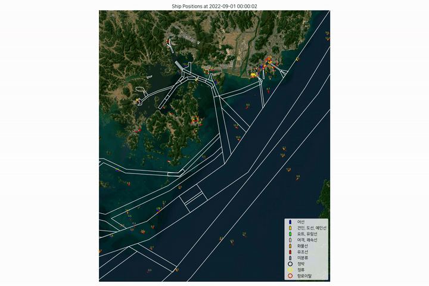
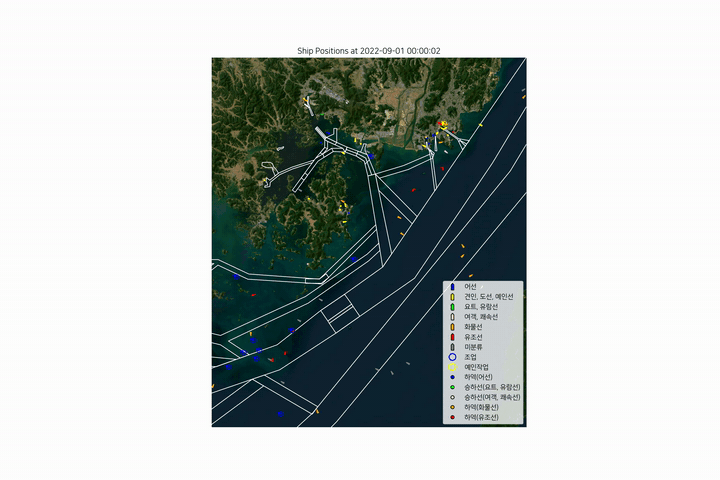
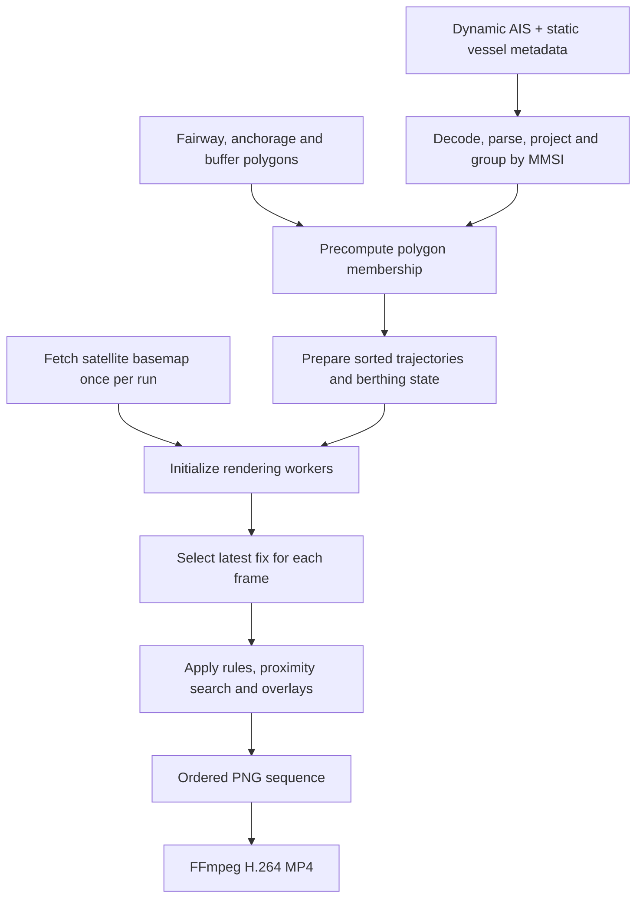

<div align="center">

# Busan AIS Ship Behavior Analysis

**From vessel trajectories to interpretable maritime behavior.**

Rule-based geospatial analysis · Vessel activity indicators · Satellite-map time-lapse

**English** · [한국어](README.ko.md)


[About](#about) · [Highlights](#highlights) · [Research presentations](#research-presentations) · [Demo](#demo) · [Quick start](#quick-start) · [Validation](#validation) · [Notes](#notes)

</div>

## About

This repository turns historical AIS (Automatic Identification System) observations around Busan into visual indicators of vessel behavior. It combines speed, heading, successive positions, vessel-type metadata, and polygon membership to highlight stationary vessels, low-speed movement, fairway exits, and possible operational activities.

The emphasis is **inspectable rules and spatial context**: analysts can trace each indicator to an explicit threshold and review it against the surrounding traffic. Two Python pipelines render time-lapse MP4s over Esri World Imagery, with vessel-type colors and Korean legends.

| Pipeline | Entry point | Analytical output |
|---|---|---|
| Navigational status | [`3docked_video_demo.py`](3docked_video_demo.py) | Stationary/anchoring indicators, loitering candidates, fairway exits, SOG labels and direction arrows |
| Operational activity | [`2acting_video2_demo.py`](2acting_video2_demo.py) | Persistent berthing candidates, fishing candidates, towing-related proximity indicators |

> [!IMPORTANT]
> Behavior labels are **heuristic candidates**, not confirmed events. AIS alone does not establish cargo handling, active fishing, a tow relationship, or an unsafe maneuver. No labeled accuracy benchmark is provided.

## Highlights

- **Transparent classification.** Speed, displacement, heading change, and polygon membership define the rules; there is no trained model or hidden score.
- **Two complementary views.** Separate navigation and activity pipelines support inspection of movement patterns and vessel interactions.
- **Spatial preprocessing.** GeoPandas joins compute route/anchorage/buffer membership before rendering; the activity renderer builds a KD-tree for proximity at each frame.
- **Time-series state.** MMSI groups are sorted once and queried with `numpy.searchsorted`. Berthing state is computed before parallel rendering.
- **Parallel video generation.** A process pool renders 3000 × 2000 RGB frames; ordered `imap` results are saved as temporary PNGs and encoded with FFmpeg.
- **Evidence-aware documentation.** Local input inventories, quality findings, and validation limits are recorded in [the validation report](VALIDATION.md).

<a id="research-presentations"></a>

## Research presentations

The 2024 conference poster and 2025 workshop deck provide research context, methods and examples alongside the public code. Their study settings are not assumed to match the current implementation.

| Material | Context | Original |
|---|---|---|
| 2024 conference poster | Fall conference of 한국해양환경에너지학회 · AIS anchoring, drifting and behavior study | [한국어 원문 PDF](https://fortranmentis.github.io/assets/research/ais-poster-ko.pdf) · [English translation PDF](https://fortranmentis.github.io/assets/research/ais-poster-en.pdf) |
| 2025 workshop | **January 14, 2025**, Technical Exchange Workshop for Maritime Traffic Network Operations and Management · Sang Hak Lee | [PPTX · 31.2 MB](https://fortranmentis.github.io/assets/research/ais-workshop-2025.pptx) |

The English poster is the supplied translation, not represented as an original English conference submission. Original documents are served from GitHub Pages.

### Methods presented at the workshop

- **Data:** 2022 Busan-area static AIS identifiers/types and dynamic time, position, SOG, course and heading.
- **Processing:** Python multiprocessing with ordered `imap` output.
- **Navigation states:** Position, speed, heading, fairway/anchorage membership and arc-like, linear or Z-shaped movement patterns inform anchoring, drifting and fairway-exit criteria.
- **Vessel-type activity:** Six broad vessel groups use persistent low speed, port membership and co-movement/proximity to display activity candidates.

<table>
<tr>
<td width="50%"><a href="https://fortranmentis.github.io/assets/research/ais-workshop-navigation.webp"></a><p>Slide 10 · Anchoring, drifting and fairway-exit indicators</p></td>
<td width="50%"><a href="https://fortranmentis.github.io/assets/research/ais-workshop-activities.webp"></a><p>Slide 11 · Vessel-type activity candidates</p></td>
</tr>
</table>

Whole embedded images from the deck retain their legends and Esri/other basemap credits. They illustrate research outputs; they are not event ground truth or accuracy measurements.

### Presentation settings versus public code

| Topic | Presentation | Public implementation documented here |
|---|---|---|
| Low-speed criterion | Below 0.5 knots in the study classification | `SOG_STOPPED = 2.1` knots plus spatial, displacement and heading conditions |
| Fairway-exit display | Five-minute retention, cleared on re-entry | Previous/latest membership transition with report gap `< 600 s`; the same pair may persist until the next AIS fix |
| Time and execution | Research system described with one-second updates/display | Historical AIS sampled at `FRAME_STEP_SEC = 1` for PNG/MP4 rendering; no verified live-stream acquisition or operation |
| Follow-up work | Wind/current integration, richer drifting patterns, individual trajectories and accident detection | Not represented as fully implemented in the two public demos |

The **Classification rules** below remain the source of truth for the public code. This documentation update does not change thresholds to match the slides. The [validation record](VALIDATION.md) does not certify classification accuracy or live operational performance.

<details>
<summary>Preview the 2024 conference poster</summary>

<table><tr>
<td width="50%"><a href="https://fortranmentis.github.io/assets/research/ais-poster-en.pdf"></a><p>English translation</p></td>
<td width="50%"><a href="https://fortranmentis.github.io/assets/research/ais-poster-ko.pdf"></a><p>한국어 원문</p></td>
</tr></table>

</details>

[Workshop research overview](https://fortranmentis.github.io/#ais-workshop) · [Conference poster overview](https://fortranmentis.github.io/#research)

## Demo

| Navigational status | Operational activity |
|:---:|:---:|
|  |  |
| [View MP4](assets/ship_movement_DOCK_SPEED_demo2.mp4) · `3docked_video_demo.py` | [View MP4](assets/ship_movement_act2_demo.mp4) · `2acting_video2_demo.py` |

**Read the overlays:** filled circles denote stationary or latched berthing states; yellow rings in the navigation view mark loitering candidates; red rings mark an observed fairway exit. In the activity view, blue rings mark fishing candidates and yellow rings mark towing-related candidates. Vessel-type colors are distinct from behavior overlays.

Both bundled GIFs are 720 × 480, with 167 frames and 16.7 seconds of playback. They are existing illustrative assets; their generation settings and correspondence to the current code have not been revalidated.

## Quick start

### 1. Clone and prepare the environment

Python 3.10+ is a suggested environment target; dependencies are not pinned and no tested version matrix is declared. Install all directly used libraries and FFmpeg, for example:

```bash
git clone https://github.com/fortranmentis/Busan-AIS-ship-behavior-analysis.git
cd Busan-AIS-ship-behavior-analysis
conda create -n busan-ais -c conda-forge python=3.10 pandas numpy geopandas shapely matplotlib contextily scipy pillow tqdm psutil ffmpeg
conda activate busan-ais
```

Provide a Korean font (Windows Malgun Gothic or a supported Nanum font) and network access for the satellite basemap. GPU hardware is optional: navigation requests NVENC and falls back to `libx264`; activity uses `libx264` by default.

### 2. Supply the inputs

The public repository contains demo scripts, the shared module, documentation, and media. **AIS CSVs and Shapefiles are local inputs excluded by `.gitignore`.** A fresh clone cannot render a video until these inputs are supplied.

Place files beside the scripts, or edit input paths in each `main()`. Both entry points change the working directory to the script directory.

| Input | Required by | Purpose |
|---|---|---|
| `busan_AIS2.csv` | Both | Dynamic vessel observations |
| `Static.csv` | Both | MMSI-to-vessel-type lookup |
| `제1광역항로_5.shp`, `제2광역항로_5.shp`, `지선항로_5.shp`, `고시항로_2023.shp` | Both | Combined fairways; activity uses these as a visual overlay |
| `고시정박지_2023.shp`, `정박지(KOMC)_2023_병합.shp`, `무역항_2024.shp` | Navigation | Combined `in_anchorage` area, including trade-port polygons |
| `100m버퍼3.shp` | Activity | Buffer polygons for `in_port` and berthing state |

Keep each Shapefile's `.shp`, `.shx`, `.dbf`, and `.prj` together, plus `.cpg` where supplied. All eight referenced local layers declare WGS 84 geographic coordinates. The loader **overrides CRS to EPSG:4326**, converts to EPSG:3857, and applies `buffer(0)`; supply actual WGS 84 coordinates. Assigning a CRS does not reproject source coordinates. Local `100m버퍼2.shp` is UTM Zone 52N and is not a drop-in substitute.

### 3. Render a preview

```bash
python 3docked_video_demo.py --frames 100 --fps 30 --output navigation_preview.mp4
python 2acting_video2_demo.py --frames 100 --fps 30 --output activity_preview.mp4
```

Increase `--frames` after checking inputs and the preview:

```bash
python 3docked_video_demo.py --frames 1000 --fps 30 --output navigation_1000.mp4
```

| Option | Default | Meaning |
|---|---|---|
| `--frames` | `100` | Requested frame cap, also limited by the input time span |
| `--fps` | `30` | Playback frames per second |
| `--output` | `ship_movement_DOCK_SPEED_demo2.mp4` / `ship_movement_act2_demo.mp4` | Navigation / activity output path |

At `FRAME_STEP_SEC = 1`, 1,000 frames sample offsets 0–999 seconds and produce about 33.3 seconds at 30 FPS. Playback speed does not change classification thresholds. Use positive frame counts/FPS and a nonzero input time span. FFmpeg overwrites an existing output of the same name.

## Data contract

| Dataset | Field | Meaning / expected value |
|---|---|---|
| Dynamic | `MMSI` | Vessel identifier; use a consistent representation in dynamic and static files |
| Dynamic | `일시` | Parsed with `%Y-%m-%d %H:%M:%S`; the code does not assign a timezone |
| Dynamic | `경도`, `위도` | WGS 84 longitude and latitude in degrees |
| Dynamic | `SOG` | Speed over ground in knots |
| Dynamic | `Heading` | Bow direction; `511` means not available and currently passes through |
| Dynamic | `COG` | Optional course over ground for navigation arrows; absent/missing values fall back to `Heading` |
| Static | `MMSI`, `선종코드` | Identifier and AIS ship-type code; other static fields are unused by the demos |

CSV decoding tries UTF-8 BOM, CP949, EUC-KR, then UTF-8. Dynamic records have no separate cleaning stage. The static reader uses `on_bad_lines='skip'`; duplicate static MMSIs would resolve to the last dictionary value. Validate parsing losses, duplicate timestamps, coordinates, and metadata coverage before interpretation.

<details>
<summary><strong>Vessel-type color mapping</strong></summary>

| AIS ship-type code | Display group | Color |
|---|---|---|
| `30` | Fishing | Blue |
| `31`, `32`, `50`, `52` | Towing / pilot / tug group | Yellow |
| `36`, `37` | Sailing / pleasure craft | Lime |
| `40–49`, `60–69` | High-speed / passenger craft | Pink |
| `70–79` | Cargo | Orange |
| `80–89` | Tanker | Red |
| Other, missing, or unmatched | Unclassified | Gray |

The towing-related rule uses the entire yellow display group, including pilot vessels; it is not restricted to tug code `52`.

</details>

## Classification rules

These thresholds describe the current implementation, not empirically established operating standards. Adjacent observations are compared within each MMSI group.

### Navigational status

| Indicator | Implemented condition | Display |
|---|---|---|
| Stationary inside analysis area | `SOG ≤ 2.1 kn` and `in_anchorage` | Filled vessel-color circle |
| Stationary outside analysis area | `SOG ≤ 2.1 kn`, previous fix available, gap `≤ 200 s`, and (displacement `≤ 10 m` **or** wrapped Heading change `≥ 10°`) | Filled vessel-color circle |
| Loitering candidate | Same low-speed/previous-fix/gap conditions, but displacement `> 10 m` **and** Heading change `< 10°` | Yellow ring plus vessel marker |
| Fairway exit | Previous fix inside combined routes, latest fix outside, report gap **`< 600 s`** | Red ring, independent of stationary classification |
| Remaining observations | No filled stationary circle, including low-speed records with no eligible previous fix | Directional vessel marker |

Displacement uses haversine on longitude/latitude. A loitering ring is **not** drawn for every low-speed vessel. Fairway exits indicate membership transitions, not proof of violations. The red indicator can persist until the next AIS report because the latest/previous pair is reused across frames.

SOG labels appear when `SOG > 0`; direction arrows are drawn for every displayed vessel, including stationary ones. `in_anchorage` is the union of anchorage **and trade-port** polygons, so a filled circle does not distinguish actual anchoring from being stationary within a port.

### Operational activity

| Indicator | Implemented condition | Display |
|---|---|---|
| Berthing candidate | Enter when inside `100m버퍼3.shp` and `SOG ≤ 2.1 kn`; leave when `SOG > 2.1 kn`; otherwise retain previous state | Filled vessel-color circle |
| Fishing candidate | Not berthed; blue vessel group and `0 ≤ SOG ≤ 5 kn` | Blue ring |
| Towing-related candidate | Not berthed; yellow group, `0.5 ≤ SOG ≤ 8 kn`, and another displayed vessel within `PROXIMITY_RADIUS` | Yellow ring |

Berthing takes display priority and suppresses activity rings. The nominal 100 m buffer width is implied by its filename; construction was not independently verified. Proximity uses all latest displayed fixes without partner-type, bearing, duration, or freshness constraints.

`PROXIMITY_RADIUS = 0.0051 × 111319.49079327358 ≈ 567.7` **EPSG:3857 map units**. Web Mercator distances are latitude-dependent; this is not an exact 568 m ground-distance criterion.

## Architecture



[`ais_common.py`](ais_common.py) centralizes CSV loading, ship colors, geometry preparation, spatial joins, heading/distance helpers, fonts, basemap acquisition, and encoding. Entry points configure their layers and frame renderers.

**Performance design:** membership is computed once per observation; binary search avoids repeated full-data filtering; workers receive a payload via the pool initializer; ordered `imap(..., chunksize=10)` preserves frame order. Frames are saved incrementally rather than assembled into one result list.

Worker count is `min(physical cores + 2, logical cores)`. Windows workers can each hold a payload copy; ordered result buffering can increase memory when a frame is slow. Temporary PNG storage grows with frame count. No runtime or peak-memory benchmark is claimed.

## Validation

**Documentation and local input audit: 2026-10-14.** These are aggregate findings from the working folder, not downloadable public data or classification accuracy scores.

| Check | Observed result | Interpretation |
|---|---|---|
| Dynamic input | **787,591 rows · 1,070 MMSIs** | Historical extract: `2022-09-01 00:00:00`–`05:59:58`; timezone unspecified |
| Dynamic completeness | No empty values in seven supplied columns; no out-of-range/non-numeric lon/lat or negative/non-finite SOG found | Basic checks; not a sampling-quality or AIS-validity assessment |
| Heading availability | **455,162 records (57.79%) contain `Heading=511`** | Direction markers and heading-change rules need careful interpretation |
| Static metadata | **55,630 rows · 55,630 MMSIs**, 318 empty ship-type fields | No duplicate static MMSIs; some ship-type data are missing |
| Metadata coverage | **13 of 1,070 dynamic MMSIs have no static match** | Those identifiers fall back to gray |
| Spatial inputs | **8 of 8** sets have `.shp/.shx/.dbf/.prj`; WGS 84 declared | Header/CRS inventory; topology and buffer width not validated |
| Public modules | All **3** parse successfully with Python AST | Syntax only; no import, rendering, or encoding verification |
| Demo GIFs | Both decoded frame by frame: **720 × 480 · 167 frames · 16.7 s** | Readability verified; event correctness not assessed |

See [Validation details and reproduction checks](VALIDATION.md) for methodology and remaining evaluation. Full rendering was not rerun: inspected Python environments lack required geospatial/rendering dependencies, and FFmpeg was not on `PATH`.

## Notes

- **Time semantics.** A one-second render step is playback sampling, not one-second AIS coverage. Latest fixes are held without interpolation or a maximum-age cutoff; stale fixes affect maps and proximity indicators.
- **Missing directions.** `HEADING_NOT_AVAILABLE = 511` is defined but not used to mask directions or exclude heading changes. Missing COG falls back to Heading, which may also be unavailable.
- **Bearing convention.** Both demos use mathematical angles (east = 0°, counterclockwise), rather than AIS compass bearings. The shared helper supports `compass=True`, but marker and navigation-arrow call sites do not enable it.
- **Spatial semantics.** `within` excludes boundaries. `buffer(0)` is a geometry operation, not a quality report. EPSG:3857 supports map display but requires care for physical-distance analysis.
- **Historical geography.** AIS is from 2022; layer filenames include 2023 and 2024. Check whether boundaries were valid on the observation date before interpreting zone membership or departures.
- **Output scope.** Entry points export videos, not event CSVs, statistical summaries, vessel-level evaluations, or real-time monitoring. Existing media are illustrations, not evaluation evidence.
- **Provenance and attribution.** Imagery is fetched through [contextily](https://github.com/geopandas/contextily). Preserve provider attribution and check imagery/data reuse terms when sharing outputs. Original AIS acquisition provenance and spatial-layer redistribution terms are not documented here.
- **License.** No `LICENSE` file is present; this README does not assert an open-source license.

<details>
<summary><strong>Tuning and troubleshooting</strong></summary>

| Setting / symptom | Where to look / action |
|---|---|
| Stopped threshold | `ais_common.SOG_STOPPED = 2.1` knots |
| Stationary comparison | Navigation: `STOP_WINDOW_SEC = 200`, `STOP_DISTANCE_M = 10`, `TURN_THRESHOLD_DEG = 10` |
| Fairway exit gap | Navigation: `DEPARTURE_WINDOW_SEC = 600`, strict `<` comparison |
| Activity thresholds | `FISHING_SOG_MAX = 5`; `TOWING_SOG_MIN/MAX = 0.5/8`; `PROXIMITY_RADIUS` |
| Simulation step | `FRAME_STEP_SEC = 1` in both scripts; independent of `--fps` |
| Missing input | Check filenames beside the scripts and Shapefile companions |
| FFmpeg not found | Install it; helper checks `PATH` then `sys.prefix/Library/bin/ffmpeg.exe` |
| NVENC failure | Navigation retries `libx264`; different codecs/settings can yield different outputs |
| Korean glyphs missing | Install a supported Nanum font or use Windows Malgun Gothic |
| Basemap request fails | Check network access; no explicit offline fallback in `fetch_basemap()` |
| High RAM / disk usage | Reduce workers in code, figure size/DPI, frame count or input extent |

Tune against labeled examples, vessel classes, and reporting intervals. Retain input versions, code revision, environment, and parameters with results.

</details>

## Repository map

```text
.
├── README.md                       # English landing page
├── README.ko.md                    # Korean documentation
├── ais_common.py                   # Shared geospatial/rendering utilities
├── 3docked_video_demo.py            # Navigational status video
├── 2acting_video2_demo.py           # Operational activity video
├── VALIDATION.md                   # Audit evidence and validation limits
└── assets/                         # Two GIF previews and two MP4 demos
```

The working folder also contains untracked historical scripts, alternative inputs, backups, and larger videos. They are outside the public entry points and are not required merely because they exist locally.

## Next steps and contributions

- [ ] Mask AIS sentinel values; add fix-age limits and duplicate-time handling.
- [ ] Respect source CRS and use a suitable local metric CRS for proximity.
- [ ] Separate anchorage, port, and berth concepts; version geography by observation date.
- [ ] Externalize paths, worker count, time window, and bearing mode.
- [ ] Export timestamped candidates and review against independent event labels.
- [ ] Pin environments and publish runtime, memory, and classification benchmarks.

For issues or PRs, include input schema, parameters, and a minimal reproducible example. Share synthetic or appropriately anonymized data rather than raw AIS extracts.

